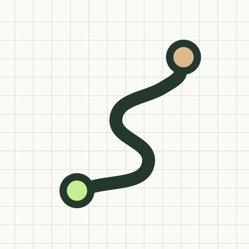

# RideDiary / 途记

**Your everyday rides, a little better understood.** · [中文说明](README.zh-CN.md) · [Changelog](CHANGELOG.md)

Current version: **0.1.7**

RideDiary is an offline trip journal that helps you understand your commute and compare it with earlier trips on the same route. For Android 8.0 and later; no account, extra hardware or Google Play services needed.

## Features

- **Record trips:** see elapsed time, distance, average speed, stationary time and location status, with motorcycle progress after route recognition.
- **Manage routes:** keep work/home tracks under one route name, with automatic matching and manual correction.
- **Explore statistics:** view monthly distance, commute days and trip count across both directions, then select a direction for durations and charts.
- **Review history:** inspect time breakdowns, stops, tracks and historical comparisons; correct classification, adjust boundaries, exclude or delete trips.

## Getting started

1. Open the APK and follow your phone's installation prompts; install updates over the existing app to retain your records.
2. While parked, tap **Start recording**, grant precise location and enable system location.
3. To finish, choose **Cancel** to continue, **Delete** to discard this trip, or **Save** to keep it; notification finish and detected arrival offer the same choices, and recording continues until you decide.
4. After saving, review the matched route, select an existing route or use **Create a new route** at the top; a missing work/home direction can use the current track.
5. In Statistics, choose a month and route, then To work / To home; open a trip in Trips for details.

Chinese is the default language; change the language in Settings at the top right. Operate the app while parked.

## Permissions and conditions

| Permission or condition | Purpose and effect |
|---|---|
| Precise location | Records tracks and recognizes routes; denied or approximate-only access prevents recording, but history remains available |
| Notifications, Android 13+ | Shows recording status and a finish entry; if denied, return to the app to finish |
| System location enabled | Supplies fixes; when disabled or unavailable, timing continues and unclassifiable intervals are unknown |

No “Allow all the time” location access is required; trips never start automatically or at boot.

## Using RideDiary

- **Routes and history:** creating a route needs four valid fixes and 150 m of track; endpoint radii are 20–500 m, and historical comparison/arrival estimates need three usable histories for the same direction.
- **Arrival prompts:** near-complete progress and at least 30 seconds of sustained low speed may trigger review, but Save/Delete still requires your choice; similar routes, deviation or poor fixes can prevent recognition and estimates.
- **Time breakdown:** elapsed time equals moving, stationary and unknown time; estimates do not include live traffic.
- **Screen and battery:** the visible app stays awake during recording and restores normal timeout when you leave or finish; the power button can lock the screen while background recording continues, and location/screen use increases battery consumption.
- **Edits and deletion:** hold a trip or route card for management, or browse linked trips inside a route, open details or hold to unlink; deleting a route keeps trips, while deleting a trip removes its raw track.
- **Interruptions:** time to the first fix depends on surroundings; if recording is interrupted, check location and app background restrictions, then reopen to inspect saved data without automatic resumption.

## Data and limits

Records stay on your phone without uploads. **Uninstalling or clearing app data loses records; export, import and cloud recovery are not available yet.**

Track sketches are available; map basemaps, navigation, live traffic and red-light detection are not. Location accuracy and background continuity depend on surroundings and your phone's system.

## Planned features

- Local track/statistics export, backup and import.
- Stationary hotspots, segment analysis and estimates informed by usual departure times.
- Easier route editing, large text, screen readers, larger screens and dark mode.

These features are not all available yet; see the changelog for delivered updates.
